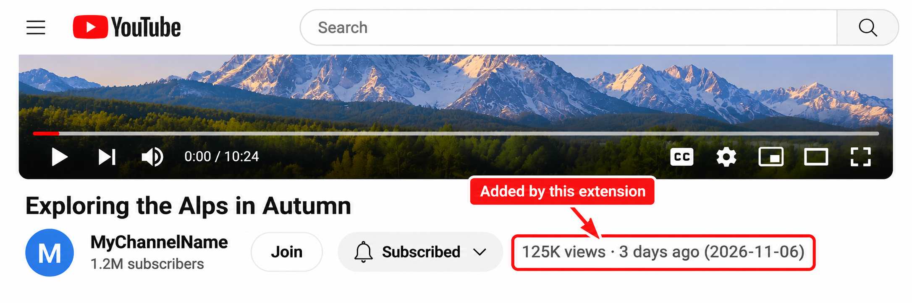

# YouTube Inline Views & Date

Display video view counts and publication dates **to the right of the channel action buttons** (Join / Subscribe / Notification Bell) on YouTube watch pages.

For example:

`125K views · 3 days ago (2026-11-06)`

## 1. Features

- Display view counts, relative publication dates, and exact publication dates (`YYYY-MM-DD`) on the same line as the channel action buttons.
- Extract exact publication dates from YouTube's built-in video metadata. If a reliable date is unavailable, omit the exact date rather than estimating it.
- Use subtle text colors that adapt to YouTube's light and dark themes.
- Preserve the original video description and metadata.
- No external network requests, accounts, or API keys required.

## 2. Installation

### 2.1. For Users

Install **YouTube Inline Views & Date** directly from the Chrome Web Store: https://chromewebstore.google.com/detail/REPLACE_WITH_EXTENSION_ID

The extension works with Chromium-based browsers, including Google Chrome and Brave.

Once installed, open any YouTube video. The view count and publication date will automatically appear next to the channel action buttons.

No additional configuration is required.

### 2.2. For Developers

To install the extension manually for development or testing:

1. Clone or download this repository.
2. Open `chrome://extensions` in Chrome or `brave://extensions` in Brave.
3. Enable **Developer mode**.
4. Click **Load unpacked**.
5. Select the repository folder containing `manifest.json`.
6. Open or refresh a YouTube video page.

After modifying the source code, click **Reload** on the extension management page and refresh YouTube to apply your changes.

## 3. Screenshot

*Example showing view counts and publication dates displayed next to the channel action buttons.*

## 4. Notes

- YouTube frequently changes its page structure, which may affect the extension's functionality.
- On narrow browser windows, the displayed text may be truncated. Hover over it to view the full information.
- Date handling may differ for live streams and premieres.
- The extension does not modify or remove YouTube's original video metadata.
